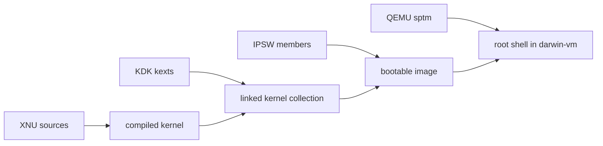

# Darwin Verified Instances

   
  <a href="http://www.hexley.com">Hexley</a> DarwinOS Mascot Copyright 2000 by Jon Hooper. All Rights Reserved.

Darwin bench follows the same design structure as SEC-bench Pro. It allows booting XNU kernel for bug reproduction, security analysis, patch verification, and agent benchmarks entirely in a container.

## Data flow

## Support tiers

| tier | hosts | toolchain | guests |
|---|---|---|---|
| **Tier 1** supported | Ubuntu 26.04 LTS amd64 and arm64; macOS 27 on Apple-silicon | LLVM 24, Docker 28-29 | macOS 26-27 |
| **Tier 2** best effort | Ubuntu 24.04 LTS amd64 and arm64; macOS 26 on Apple-silicon | LLVM 23, Docker 25-27 | macOS 14-15 |
| **Tier 3** experimental | older or non-Debian Linux, older macOS | older LLVM, older Docker | macOS 11-13 with HFSX ramdisk, iOS |
| **Tier 4** not supported | Windows, Intel based Mac | | OS X, macOS < 11 |

## Start here

Pick the row that matches the type of deployment environment you want to work in. Each quick start lists what to install and how large a machine to use.

| quick start | host | minimal | recommended |
|---|---|---|---|
| [Docker](quickstart-docker.md) | Docker CE (Tier 1 or Tier 2) | 4 cores, 16 GB RAM, 80 GB disk | 8+ cores, 32 GB RAM, 160 GB SSD |
| [Ubuntu](quickstart-ubuntu.md) | Ubuntu 26.04 LTS (Tier 1) or 24.04 LTS (Tier 2) | 4 cores, 24 GB RAM, 80 GB disk | 8+ cores, 32 GB RAM, 160 GB SSD |
| [macOS](quickstart-macos.md) | macOS 27 (Tier 1) or 26 (Tier 2) | 4 cores, 16 GB RAM, 80 GB disk | 8+ cores, 32 GB RAM, 160 GB SSD |

You can refer to [quickstart-agent.md](quickstart-agent.md) if you work with an AI coding agent. There are some ready-made prompts and the rules an agent needs.

## Credits

Hexley, the DarwinOS mascot by Jon Hooper ([hexley.com](http://www.hexley.com)) ·
[jprx/darwin-vm](https://github.com/jprx/darwin-vm) ·
[jprx/qemu-sptm](https://github.com/jprx/qemu-sptm) ·
[blacktop/darwin-xnu-build](https://github.com/blacktop/darwin-xnu-build) ·
[blacktop/ipsw](https://github.com/blacktop/ipsw) ·
[dortania/KdkSupportPkg](https://github.com/dortania/KdkSupportPkg) ·
[linux-apfs/linux-apfs-rw](https://github.com/linux-apfs/linux-apfs-rw) ·
[linux-apfs/apfsprogs](https://github.com/linux-apfs/apfsprogs) ·
[ProcursusTeam/ldid](https://github.com/ProcursusTeam/ldid) ·
[doronz88/applecatalog](https://github.com/doronz88/applecatalog) ·
[tpoechtrager/cctools-port](https://github.com/tpoechtrager/cctools-port) ·
[Nyktis/iig-port](https://github.com/Nyktis/iig-port) ·
[checkra1n/libdmg-hfsplus](https://github.com/checkra1n/libdmg-hfsplus) ·
[apple-oss-distributions](https://github.com/apple-oss-distributions) (xnu, dyld, libdispatch, bootstrap_cmds, cctools)

## Disclaimer

Research purpose only. This software is not affiliated with, sponsored by, or endorsed by Apple Inc. Users are responsible for complying with the license agreements that govern the Apple software this project downloads and uses on their machines (the macOS software license agreement, the Kernel Debug Kit and Xcode license agreements, and the Apple Public Source License for the open-source components) and with the laws of their jurisdiction. Use this project at your own risk: it is provided as is, without warranty of any kind, and the authors accept no liability for any damage, data loss or legal consequence arising from its use.

Apple, the Apple logo, Mac, macOS, OS X, Xcode, and Swift are trademarks of Apple Inc., registered in the U.S. and other countries and regions. Other product and company names mentioned herein may be trademarks of their respective companies.

## License

This directory follows the repository license. See `../../LICENSE`.